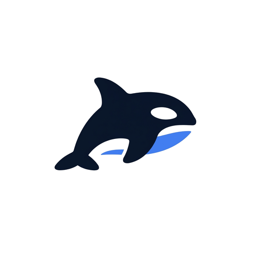

<div align="center">



# Orkas

**A local-first team of AI agents that turns your goals into finished work**

[](https://snapcraft.io/orkas)
[](https://snapcraft.io/core26)

[](https://snapcraft.io/publisher/sidaliteir)


[Getting Started](#getting-started) · [Configure](#configure) · [Limitations](#limitations) · [Build](#build) · [Support](#support) · [License](#license)

Unofficial snap packaging for [Orkas](https://github.com/Orkas-AI/Orkas), a multi-agent desktop app that works with the model provider of your choice.

</div>

---

## Getting Started

<a href="https://snapcraft.io/orkas"></a>

```bash
sudo snap install orkas
orkas
```

You can also launch Orkas from the application menu. Open **Configure models** and add an API key for Claude, OpenAI, Gemini or another provider, or point Orkas at an OpenAI- or Anthropic-compatible endpoint such as a local Ollama or LM Studio server.

## Configure

Use the application's settings. There are no `snap set` options.

```bash
sudo snap connect orkas:audio-record       # optional: voice input
sudo snap connect orkas:camera             # optional: camera capture
sudo snap connect orkas:removable-media    # optional: files on /media, /mnt
```

Data, agent workspaces, Python and Node package environments and caches are stored in `~/snap/orkas/common`.

## Limitations

- Agent commands run inside the snap with bash, the core utilities, git, ripgrep, curl, jq and the Python, Node, FFmpeg, whisper.cpp and OfficeCLI runtimes that Orkas bundles. Tools installed on your system, including Claude Code, Codex and other CLI agents, cannot be used.
- Files must be in your home directory or connected removable storage. Hidden folders in your home directory are not accessible.
- Local embeddings for the Library run on the CPU only.
- An existing source checkout's data is not imported. Application updates are managed by snapd.

## Build

```bash
git clone https://github.com/sidalit/orkas-snap.git
cd orkas-snap
sudo snap install snapcraft --classic
snapcraft pack
```

## Support

- **Installation or snap issues:** [open a packaging issue](https://github.com/sidalit/orkas-snap/issues).
- **Application bugs:** [report them upstream](https://github.com/Orkas-AI/Orkas/issues).

## License

Snap packaging: [MIT](https://github.com/sidalit/orkas-snap/blob/main/LICENSE).
